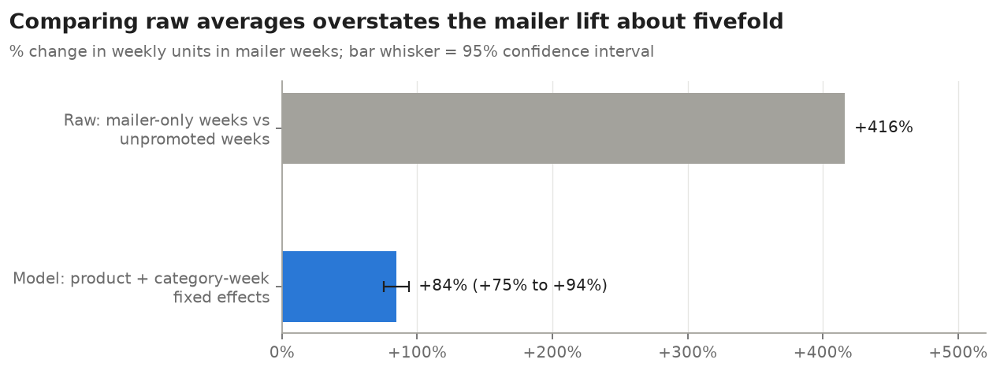
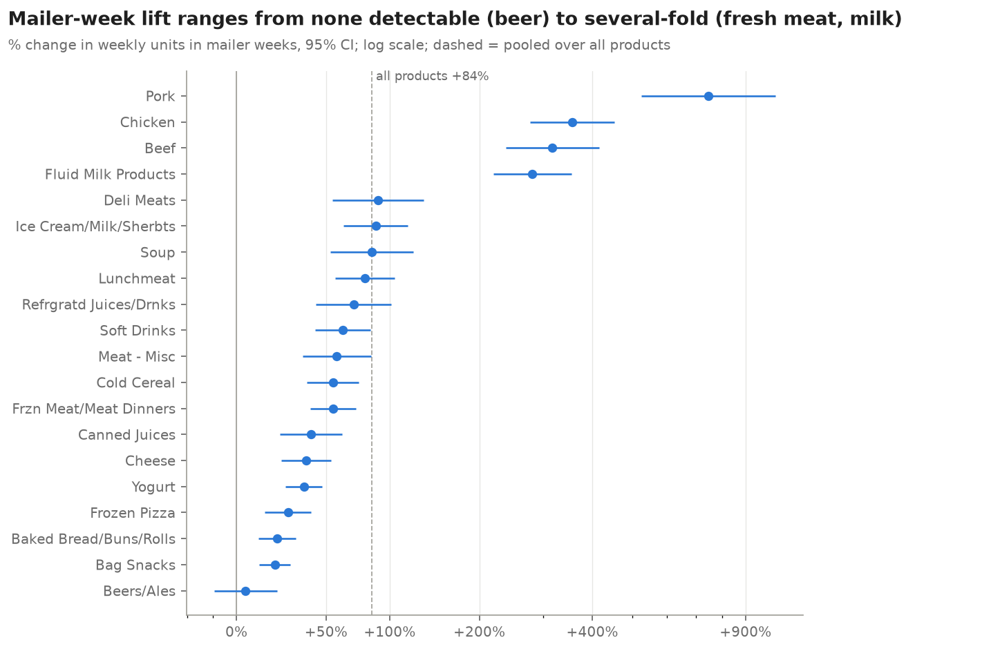
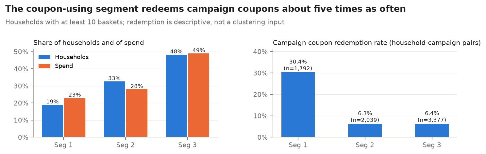
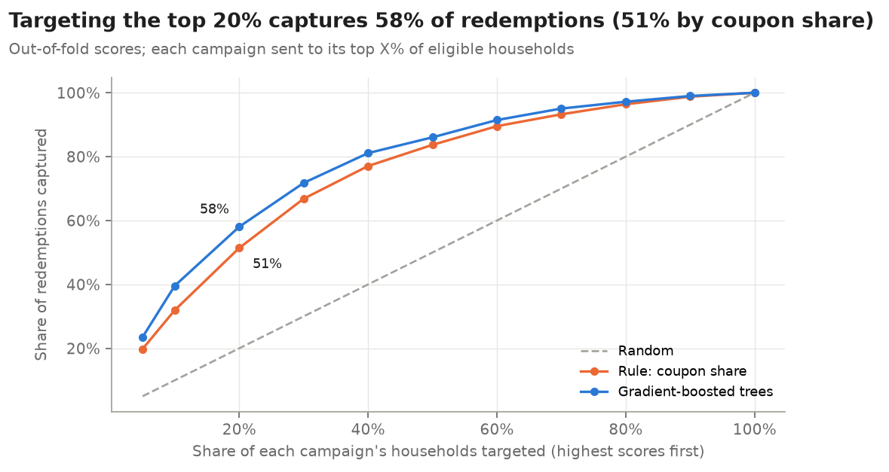

# Promotions, customers and coupon targeting: what the data says

*For a pricing and promotions manager. Based on dunnhumby's The Complete Journey: two years of purchases by 2,500 frequent-shopper households at one grocery retailer. Every number below comes from the project notebooks, cited in brackets (for example [10 §4] = notebook `10_promo_effectiveness`, section 4).*

## Summary

- **Weeks with a mailer feature sell about 84% more units** of the featured product (+84.4%, 95% confidence interval +75.3% to +94.1%), not the five-fold lift a raw comparison suggests [10 §3]. Fresh meat and milk respond most; snacks, bread and beer least [10 §4].
- **An in-store display goes with 2.8 to 4.6 times normal sales** in the stores that have it, depending on the category [10 §5].
- **Part of the product-level lift is switching within the category**: category totals rise by less (+61.2% vs +97.6% on the same categories), although the two estimates overlap [10 §6].
- **Households fall into three stable price-and-promotion segments**; one in five households, the coupon users, redeem campaign coupons about five times as often as everyone else [20 §6].
- **A model chooses coupon recipients better than the best simple rule**: sending a campaign to the top 20% of eligible households would have captured 58.5% of its redemptions, against 51.4% using past coupon use and 20% at random [30 §5].

All promotion results are associations, not proven causal effects (see "What the results do not show").

## 1. Data and how it was prepared

Raw files were loaded into Delta tables on Databricks in three layers: bronze (raw as received), silver (typed and checked) and gold (built for analysis). Problem rows are flagged rather than deleted, and every change is logged with its reason [02 §3]:

| Issue | Rows | Action |
|---|---:|---|
| Product-store-weeks listed twice with conflicting promotion codes | 30,490 | collapsed: a week counts as promoted if either row says so |
| Exact duplicate coupon rows | 5,164 | dropped |
| Fuel and other non-merchandise lines (quantity not in units) | 30,454 | flagged, excluded from unit analysis |
| Lines with zero quantity | 14,466 | flagged |
| Floating-point noise in money fields | 56 | rounded to cents |

Every error-level check passed on the latest run [04 §2]. Promotion status (display and mailer) is recorded only for 115 stores in weeks 9–101, so promotion measures cover those stores and weeks [20 key terms].

## 2. Which promotions lift sales

- Comparing promoted with unpromoted weeks directly overstates the effect about five-fold (+416% vs +84.4%), because the products that get promoted sell more anyway [10 §3]. The model compares each product with its own unpromoted weeks, adjusting for each category's week-to-week pattern.
- The "unpromoted" weeks are not discount-free: 39.0% of them carry a loyalty discount, averaging 7.5% off the shelf price across all such weeks, against 91.2% and 26.5% off for mailer-only weeks [10 §3]. **Mailer-week lift is therefore the lift of the whole promotion event**, price cut included.

| Category group | Mailer-week lift [10 §4] |
|---|---|
| Fresh meat and milk | pork +745.4%, chicken +356.4%, beef +317.5%, fluid milk +281.4% |
| Snacks, bread, frozen pizza | +19.0%, +20.2%, +26.2% |
| Beers/ales | +4.3% (−9.5% to +20.2%): no detectable lift |

- **Displays**: in the stores that have one, a display goes with +175.4% (yogurt) to +364.9% (lunchmeat) more units, 2.8 to 4.6 times normal sales [10 §5].
- **Timing**: sales are slightly higher in the week after a mailer (+7.1%), not lower, so there is no sign that customers stock up and buy less later [10 §7]. Sales are also a little higher the week *before* (+3.9%), a sign that promotion timing partly follows demand [10 §7].
- **Robustness**: the mailer-week lift stays between +79.6% and +86.0% across seven alternative settings [10 §9].

## 3. Who responds: customer segments

Households were grouped by how they buy on price and promotion, each measured against what shoppers buying the same categories in the same stores would show [20 key terms].

| Segment [20 §5–§7] | Households | Share of spend | What stands out |
|---|---:|---:|---|
| 1. More promotion, more coupons | 19% | 23.0% | most frequent shoppers; redeem campaign coupons in 30.4% of campaigns |
| 2. More promotion, more own label | 33% | 28.0% | own label 29.9% of spend vs 22.4% expected; redeem 6.3% |
| 3. Less promotion, less own label | 48% | 49.0% | 4.0 points less spend on promotion than expected; redeem 6.4% |

The three segments are stable when the analysis is repeated on resampled households, but the structure is modest: they are useful groups along a continuum, not sharply separate types [20 §3].

## 4. Targeting coupon campaigns

A model predicts which households will redeem a campaign they receive, using only what was known before it started. It was judged on ranking households *within* each campaign, against the best simple rule (rank by past coupon use) [30 key terms].

- Within campaigns, the model's ranking score (ROC AUC) is 0.819 ± 0.010 against 0.784 ± 0.005 for the rule; it wins in all five test folds, by +0.035 ± 0.009 [30 §3].
- Trained only on earlier campaigns, it also ranks later campaigns better (0.835 vs 0.799) [30 §7].
- Past coupon use carries most of the signal, followed by past redemptions [30 §6].
- Sending each campaign to its top 20% of eligible households captures 58.5% of redemptions, against 51.4% with the rule [30 §5].

## 5. What the results do not show

- **Promotion effects are associations.** The retailer chooses what and when to promote, and the small "week before" effect shows timing partly follows demand [10 §7].
- **Redemption is not extra sales.** The targeting model finds households likely to *use* coupons; frequent coupon users may have bought those products anyway [30 §9].
- **The households are a panel of 2,500 frequent shoppers**, not total store sales [10 key terms], and demographics are available for only 801 of them, mostly heavier shoppers [20 §8].

## 6. Recommendations

1. **Prioritise mailer space for categories with large lifts** (fresh meat, milk) and review mailer slots for beer, where no lift is detectable [10 §4]. Check the cost of the price cuts that come with these events before expanding them.
2. **Use displays selectively**: they are associated with 2.8–4.6 times normal sales in the stores that carry them [10 §5].
3. **Send coupon campaigns by model score**, or by past coupon use if a model cannot be deployed [30 §5, §9].
4. **Treat segment 3 (half of spend) carefully**: they buy less on promotion than comparable shoppers [20 §5], so promotions aimed at them may mostly discount purchases they would make anyway. This needs testing before acting on it.

## 7. Next steps

- **Run a randomised holdout** in future campaigns: hold back a random share of eligible households and compare their purchases with those who received coupons. This measures what campaigns actually add, and allows targeting by the change a coupon causes rather than by likelihood to redeem [30 §9].
- **Measure lift by mailer placement** (front page vs interior) and add a promotion return-on-investment view using discount cost (Phase 2 future work).
- **Build a live scoring job** that scores eligible households for an upcoming campaign (Phase 5 future work).
